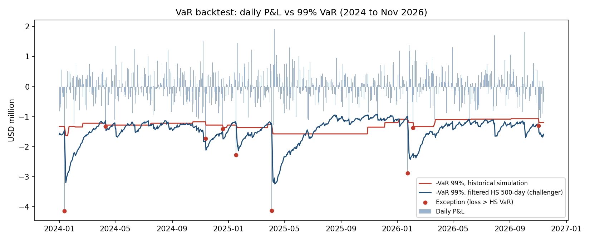
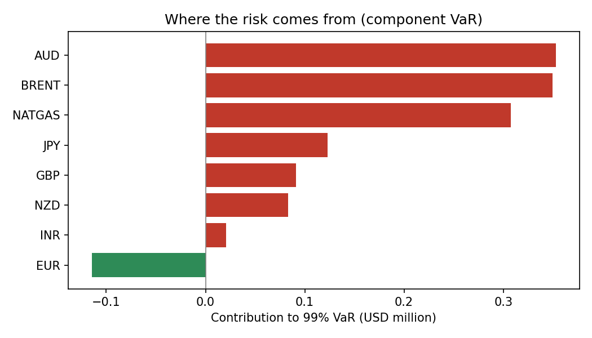
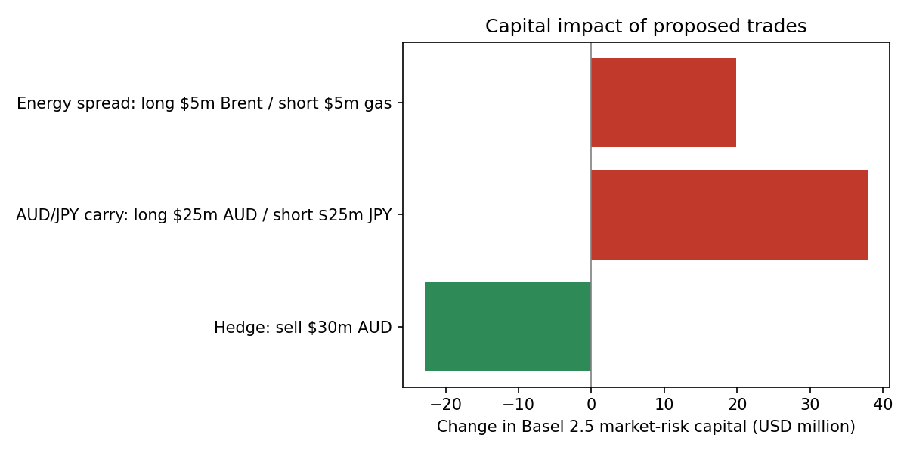

# CapitalLens: Market-Risk VaR, Backtesting and Regulatory Capital Engine

CapitalLens measures the market risk of a multi-asset FX and energy trading book on **real daily market data (2007 to Nov 2026)**. It does the core work of a market-risk team:

- calculates VaR and Expected Shortfall with several models
- backtests those models against actual P&L
- calculates Basel 2.5 regulatory capital, including stressed VaR
- measures how proposed new trades change capital
- explains the results in a plain-English memo

## The trading book (USD exposures)
| AUD | NZD | EUR | GBP | JPY | INR | Brent crude | Natural gas |
|---|---|---|---|---|---|---|---|
| +60m | +15m | -40m | +25m | +30m | -20m | +8m | -1.5m |

Gross size: USD 199.5m across 8 risk factors (6 currencies, 2 energy commodities).

## Data
Real daily prices from open datasets on GitHub that mirror the US Federal Reserve (FRED) and the US Energy Information Administration: 5,055 trading days from July 2007 to 13 Nov 2026. `fetch_data.py` aligns markets with different holidays (forward-filling at most 3 days) and writes a data-quality report. Every daily move above 25% was checked and kept as a genuine market event. Examples: Brent's April 2020 COVID crash and US natural-gas cold-snap spikes. A snapshot of the raw data is in `data/raw` so the results can be reproduced exactly.

## What it calculates
| Area | Method |
|---|---|
| VaR (99%, 1-day) | Historical simulation (250 and 500 days), parametric normal, EWMA (RiskMetrics, lambda = 0.94), filtered historical simulation (250 and 500 days) |
| Expected Shortfall | Historical 97.5% ES (the FRTB measure) |
| Backtesting | Exceptions vs expected, Kupiec proportion-of-failures test, Christoffersen independence test, Basel traffic light (green / yellow / red) |
| Stressed VaR | The 250-day window with the highest VaR for this book (found automatically: Nov 2007 to Oct 2008) |
| Capital | Basel 2.5 internal-models approach: max(VaR, m x 60-day avg VaR) + max(sVaR, m x 60-day avg sVaR), 10-day = 1-day x sqrt(10), m = 3 + plus factor |
| Risk attribution | Euler component VaR by position |
| Stress tests | 2008 crisis, Brexit, COVID 2020, 2021 gas spike, 2022 energy shock, plus hypothetical shocks |
| New-trade impact | Change in VaR, ES, stressed VaR, traffic-light zone and capital for each proposed trade |

## Key results (as of 13 Nov 2026)
- **1-day 99% VaR: USD 1.20m.** 97.5% ES: USD 1.38m. Stressed VaR: USD 4.04m.
- **Basel 2.5 market-risk capital: USD 48.7m.** 79% of it comes from stressed VaR (the 2008 crisis window). Green zone (3 exceptions in the last 250 days).
- **Backtesting over 4,533 days:**
  - The current model (historical simulation, 250-day) had **63 exceptions vs 45 expected** and fails the Kupiec test (p = 0.013).
  - The challenger, **filtered historical simulation over 500 days, had 52 exceptions** and passes both Kupiec (p = 0.33) and Christoffersen (p = 0.27).
  - The challenger would raise capital by about 5% (USD 51.1m), a trade-off between accuracy and capital.
- **New trades:**
  - An AUD/JPY carry trade adds only USD 0.1m to today's VaR but **+78% capital**. Carry trades collapsed in 2008, so stressed VaR jumps and the backtest moves to the yellow zone.
  - Selling USD 30m of AUD as a hedge cuts capital by **47%**.
- **Risk drivers:** AUD, Brent and natural gas make up 83% of VaR. The short EUR position offsets the long AUD, GBP and NZD positions.





## Outputs
- `output/CapitalLens_Market_Risk_Report.xlsx`: summary, positions, model backtests, exceptions by year, capital, champion vs challenger, component VaR, new-trade impact, stress tests, data quality, large moves checked
- `output/CapitalLens_Risk_Memo.md`: a one-page explanation for non-technical readers

## Run
```bash
pip install -r requirements.txt
python fetch_data.py     # builds data/prices.csv (uses the saved snapshot; downloads if missing)
python run_analysis.py   # risk metrics, backtests, capital, stress tests, report, charts, memo
```

## Limitations and next steps
- Hypothetical P&L uses static positions and linear exposures. A real desk would add options (Greeks), interest rates and credit.
- Spot natural-gas prices jump far more than futures, so a production model would use the futures curve.
- Next steps: FRTB internal-models ES with liquidity horizons, risk-factor eligibility tests, and a Streamlit dashboard.
